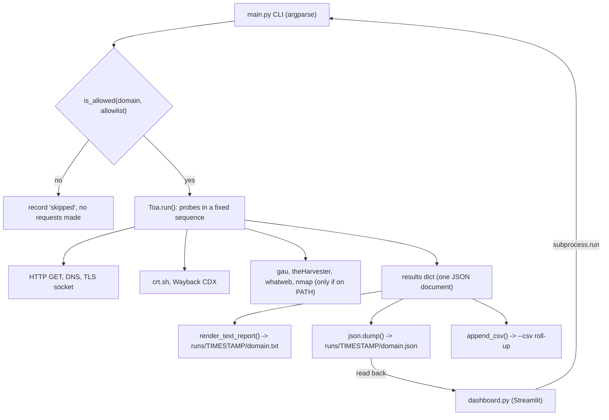

# web-recon-scanner

[](https://www.python.org/)
[](LICENSE)
[](https://streamlit.io/)
[](https://github.com/HyoAkira/web-recon-scanner/commits/main)
[](https://github.com/HyoAkira/web-recon-scanner/stargazers)

Passive web attack-surface discovery from a single URL — DNS, TLS, security headers, CORS, CVE hints, subdomain and endpoint discovery — with a Streamlit dashboard on top.

## What it is

web-recon-scanner takes one URL and produces a single JSON document plus a readable text report describing what the target exposes, what it is missing, and what it is running. It gathers only information that is reachable through plain HTTP `GET`s, public data sources, and — when explicitly enabled — a TCP port scan.

The scanner core (`main.py`) is **pure Python standard library**: it needs no `pip install` to run. The optional dashboard (`dashboard.py`) is a small Streamlit front end.

## Features

| Area | Source | What you get |
|---|---|---|
| WHOIS | `whois` | Registrar / domain record blob |
| DNS | `dig +short` | `A`, `AAAA`, `MX`, `TXT`, `NS`, `SOA` records |
| HTTP headers | `urllib` (10 s timeout) | The full response header set |
| Security headers | derived from the above | Present/missing for CSP, HSTS, X-Frame-Options, X-Content-Type-Options, Referrer-Policy, Permissions-Policy |
| CORS policy | derived | `Access-Control-Allow-Origin` / `-Credentials` / `-Methods` / `-Headers` |
| Technology fingerprint | derived | `Server`, `X-Powered-By`, `Via` |
| CVE hints | keyword match on the fingerprint | `nginx` → CVE-2021-23017, `apache` → CVE-2021-41773, `iis` → CVE-2021-31166, each tagged `hint only; verify version impact` |
| TLS / SSL | real `ssl` socket handshake | Subject, issuer, validity window, serial number, negotiated cipher, days until expiry |
| `robots.txt`, `sitemap.xml` | `urllib` | Raw bodies, also mined for paths |
| Endpoint discovery | 8 regex extractors | Every path it can reach, scoped to the target domain |
| Subdomains | certificate transparency (`crt.sh`) | Names ending in the target domain |
| Wayback URLs | Internet Archive CDX API | Archived URLs, capped by `--max-wayback` |
| External tools | `gau`, `theHarvester -b all`, `whatweb` | Optional; run through `subprocess.run`, guarded by `shutil.which` |
| Active scan | `nmap -sV --open -oX -` (XML) or `socket` fallback | Open ports and service banners — **opt-in only** |

### Endpoint discovery in detail

Eight extractors run over the homepage, its inline `<script>` blocks, up to `--max-js` JavaScript bundles, `robots.txt` and `sitemap.xml`:

1. `src` / `href` attribute values
2. path-like strings anywhere in the HTML
3. contents of inline `<script>` blocks
4. `data-*` attribute values starting with `/`
5. inline JSON string literals (`"/some/path"`)
6. `/api/...` patterns
7. `robots.txt` `Allow` / `Disallow` / `Sitemap` directives
8. `sitemap.xml` `<loc>` paths

Results are **same-domain scoped**: assets served from other hosts are not mixed into the endpoint list, they are counted separately as `third_party`. Third-party JavaScript bundles are also skipped unless you pass `--js-any-domain`.

### Risk summary

Every run ends with a `risk_summary` block classifying findings into `low` / `medium` / `high` / `info`, plus `severity_counts`:

| Finding | Trigger | Severity |
|---|---|---|
| `tls_expired` | Certificate `notAfter` is in the past | **high** |
| `tls_expiring_soon` | 30 days or fewer until expiry | **medium** |
| `cors_wildcard` | `Access-Control-Allow-Origin: *` | **medium** |
| `security_headers_missing` | One or more of the six headers absent | **low** |
| `open_ports` | Ports answered during an active scan | **info** |

Severity is a triage aid, not a verdict. The CVE hints in particular are banner-keyword matches only — see [Limitations](#limitations).

## Tech stack

- **Language:** Python 3.9+.
- **Scanner core (`main.py`):** Python standard library only — `argparse`, `csv`, `datetime`, `json`, `os`, `re`, `shutil`, `socket`, `ssl`, `subprocess`, `urllib`, `xml.etree.ElementTree`. No third-party packages.
- **Dashboard (`dashboard.py`):** Streamlit (`streamlit>=1.28`, see `requirements.txt`), driving `main.py` through `subprocess.run`.
- **Optional external CLI tools:** `whois`, `dig`, `nmap`, `gau`, `theHarvester`, `whatweb` — used only if present on `PATH`.
- **External data sources:** `crt.sh` certificate-transparency log and the Internet Archive Wayback CDX API.
- **Output formats:** JSON, plain-text report, and an optional CSV roll-up.

## Architecture



The whole scanner is a single `Toa` class in `main.py`. Constructed with a URL, it fills one `results` dictionary; `run()` calls its probe methods in a fixed order and returns that dictionary. Each probe records its own failure in `results["notes"]` and returns, so a failing or timing-out probe never aborts the run — the report always covers everything that did answer.

Network access is gated before any request: with `--allowlist-file`, `is_allowed()` is evaluated first and a non-matching target is marked `skipped: domain not in allowlist` without being contacted. External tools are resolved with `shutil.which` and skipped gracefully when absent. The dashboard adds no scanning logic of its own; it builds a `main.py` command line, runs it, and reads the resulting JSON back.

### Project layout

```
.
├── main.py           # Scanner core: a single Toa class whose run() orchestrator calls its
│                     # probes in sequence; argparse CLI; three renderers (text report,
│                     # JSON, CSV append)
├── dashboard.py      # Streamlit UI; shells out to main.py via subprocess.run
├── requirements.txt  # streamlit, for the dashboard only
├── LICENSE           # MIT
└── .gitignore
```

Output from your own scans lands in `runs/<timestamp>/` and is not tracked.

## Getting started

Prerequisites: Python 3.9+. Nothing else is required for the scanner — `main.py` imports only the standard library.

```bash
git clone https://github.com/HyoAkira/web-recon-scanner.git
cd web-recon-scanner

# Minimal run: results land in runs/<timestamp>/
python3 main.py https://example.com
```

The scanner shells out to a few conventional tools when they happen to be installed, and degrades gracefully (records `not found on PATH`, carries on) when they are not:

| Extra | Used for | Install |
|---|---|---|
| `whois`, `dig` | WHOIS and DNS records | `apt install whois dnsutils` |
| `gau`, `theHarvester`, `whatweb` | Extra URL / host / tech surface | `go install github.com/lc/gau/v2/cmd/gau@latest` · `pip install theHarvester` · `gem install whatweb` |
| `nmap` | Service-version port scan (`--active`) | `apt install nmap` |

### Dashboard

`dashboard.py` is a **Streamlit** app (not Flask). It builds the `main.py` command line from the sidebar, shows you the exact command it is about to run, executes it via `subprocess.run` in the script's own directory, then reads the JSON result back and renders it in six tabs: **Basic Network · HTTP & Security · Vulnerabilities & Risks · Discovery · Tools & Notes · Raw JSON**, with metric cards for open ports, endpoint count and subdomain count.

```bash
pip install -r requirements.txt   # streamlit only
streamlit run dashboard.py
```

## Usage

```
python3 main.py [-h] [url] [--targets-file TARGETS_FILE] [--allowlist-file ALLOWLIST_FILE]
                [--output-dir OUTPUT_DIR] [--report REPORT] [--json JSON] [--csv CSV]
                [--active] [--ports PORTS] [--full-ports] [--no-nmap]
                [--max-js MAX_JS] [--max-wayback MAX_WAYBACK] [--js-any-domain]
```

| Flag | Default | Meaning |
|---|---|---|
| `url` | — | Target URL, e.g. `https://example.com`. A bare hostname is normalised to `https://` |
| `--targets-file` | — | File with one target per line (batch mode) |
| `--allowlist-file` | — | Allowed domains, one per line; `#` comments allowed |
| `--output-dir` | `runs` | Base directory; each run gets a timestamped subdirectory |
| `--report` | — | Text report path (single-target runs only) |
| `--json` | — | JSON output path (single-target runs only) |
| `--csv` | — | Append one summary row per target to this CSV (header written on first use) |
| `--active` | off | Enable the port scan. Off by default |
| `--ports` | `80,443,22,21,25,110,143,3306,5432` | Comma-separated port list |
| `--full-ports` | off | Scan all 65535 ports with `nmap`; ignored when `--no-nmap` is set |
| `--no-nmap` | off | Skip `nmap` and use the pure-`socket` connect scan |
| `--max-js` | `5` | Maximum JavaScript bundles to fetch and parse |
| `--max-wayback` | `200` | Maximum Wayback URLs to record |
| `--js-any-domain` | off | Allow fetching JavaScript bundles from third-party domains |

### Usage examples

```bash
# Passive scan, default output (runs/<timestamp>/)
python3 main.py https://example.com

# Explicit output paths (single target)
python3 main.py https://example.com --report out/report.txt --json out/report.json

# Batch scan with a scope allowlist and a CSV roll-up
python3 main.py --targets-file targets.txt --allowlist-file allowlist.txt --csv results.csv

# Active port scan with nmap
python3 main.py https://example.com --active --ports 80,443,8080

# Active scan without nmap - plain sockets only, no external tools needed
python3 main.py https://example.com --active --no-nmap --ports 80,443

# Full port range
python3 main.py https://example.com --active --full-ports

# Deepen the discovery passes
python3 main.py https://example.com --max-js 10 --max-wayback 500 --js-any-domain
```

## Safety and authorised use

**Authorised use only.** Run this tool against systems you own or have explicit written permission to test. Scanning a third-party host without authorisation may be unlawful in your jurisdiction. Rate your scans, respect `robots.txt`, and use the findings only for remediation or defensive security. The author accepts no responsibility for misuse.

The tool is built to make the safe path the easy path:

- **Passive by default.** Nothing but plain HTTP `GET`s and public data sources are touched unless you pass `--active`. Port scanning requires that flag.
- **Allowlist enforcement.** With `--allowlist-file`, `is_allowed()` is checked *before any network request is made*; a target that does not match is recorded as `skipped: domain not in allowlist` and never contacted. The allowlist is opt-in — supply the file to enforce a scope boundary. `--active` is documented as applying to allowed targets only.
- **Batch mode with the same guard.** `--targets-file` runs one line per target through the same check.
- **No destructive actions.** No brute forcing, no exploitation, no payload delivery. The worst a scan does is open TCP connections to the ports you name.
- **Non-destructive output.** Every run writes into a timestamped `runs/<YYYYMMDD_HHMMSS>/` directory, so results never overwrite a previous run. `runs/` is git-ignored.

## What a report contains

Each run produces one JSON document and a matching plain-text report. No sample output is committed to this repository — generate your own by scanning a system you are authorised to test. The documents describe the *shape* of a target rather than any particular host:

- **Run metadata** — the target URL, the timestamp, and any per-probe failures appended to `notes`.
- **DNS records** — `A`, `AAAA`, `MX`, `TXT`, `NS` and `SOA` answers, plus the WHOIS blob.
- **HTTP headers** — the full response header set, and a present/missing breakdown of the six security headers.
- **TLS details** — subject, issuer, validity window, serial number, negotiated cipher and days until expiry.
- **Technologies detected** — whatever `Server`, `X-Powered-By` and `Via` advertise, with any matching CVE hints.
- **Discovery** — endpoints found, subdomains from certificate transparency, Wayback URLs, and third-party domains counted separately.
- **Open ports** — only when the active scan is enabled, with service banners.
- **Discovered e-mails** — addresses surfaced by `theHarvester`, when it is installed.
- **Risk summary** — findings classified `low` / `medium` / `high` / `info`, with severity counts.

The point worth noticing is the shape, not any single figure: **errors are recorded per probe and appended to `notes`; a failing probe never aborts the run.** One probe timing out still leaves you with a complete report for everything else.

## Limitations

Worth reading before you trust a result.

- **Probes run sequentially.** This is the main one. Wall-clock time is the *sum* of every probe timeout — a CT-log timeout plus a wayback timeout plus six DNS lookups adds up. The probes are completely independent and almost entirely I/O-bound, so they are obvious candidates for a `ThreadPoolExecutor`; that is the next step, not a redesign.
- **CVE detection is banner-keyword matching.** `nginx`, `apache` and `iis` are substring-matched against `Server` / `X-Powered-By` / `Via`. It cannot read a version number, so it cannot tell you whether a patch is applied, and it will happily flag a fully patched server. Every match is emitted with `hint only; verify version impact`. Confirm against the actual version and the CVE advisory before acting.
- **Endpoint discovery does not execute JavaScript.** It is regex over HTML and inline scripts. Paths assembled at runtime — string concatenation, dynamic route tables, anything behind a JS framework router — will be missed. Expect the endpoint list to be a lower bound.
- **Certificate-transparency lookups are the most common failure point.** `crt.sh` is frequently slow and often times out; a timeout there is recorded in `notes` and does not abort the run.
- **CVSS scoring is absent.** The severity labels are hand-assigned heuristics, not computed scores.
- **A 404 is not a finding.** Missing `robots.txt` / `sitemap.xml` are recorded as errors in `notes`, not as risk findings.

## Status and license

**Status:** maintained as a personal portfolio project. The scanner core and the Streamlit dashboard are implemented and usable as described above; the outstanding items are the ones listed under [Limitations](#limitations) (chiefly the sequential-probe execution).

**License:** MIT — see [LICENSE](LICENSE). Copyright (c) 2026 Umut Can Akçay.
